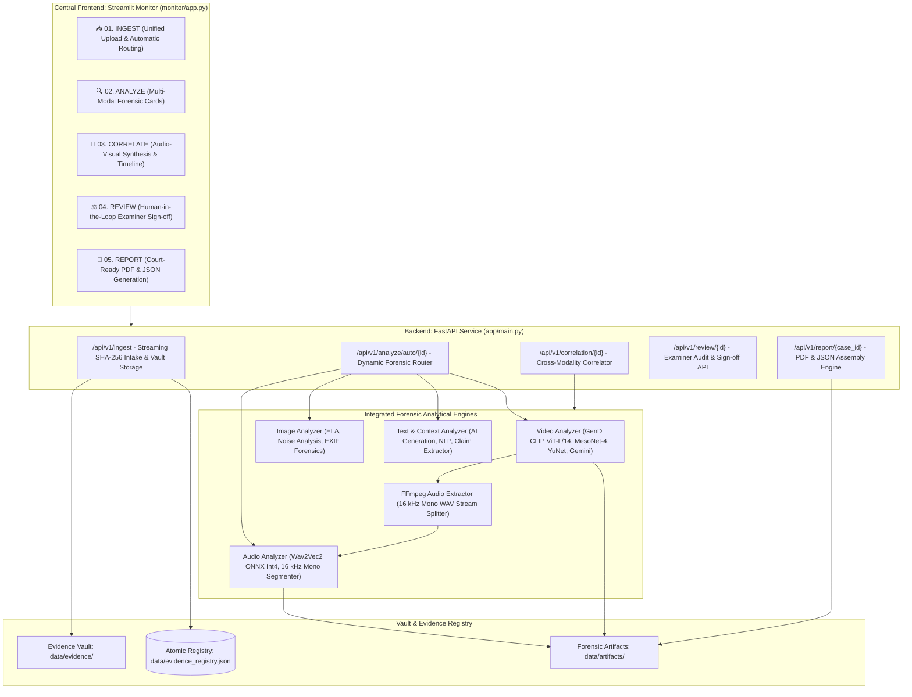

# TruthLens — Unified Multi-Modal Digital Forensics Platform

**TruthLens** is an integrated, court-ready digital forensics platform designed for tamper-evident multi-modal evidence intake, deepfake detection, cross-modality correlation, examiner review, and tamper-evident reporting.

It unifies four forensic analytical engines behind a single **INGEST** user interface and follows the strict five-stage forensic workflow:

$$\text{INGEST} \longrightarrow \text{ANALYZE} \longrightarrow \text{CORRELATE} \longrightarrow \text{REVIEW} \longrightarrow \text{REPORT}$$

---

## Architecture Overview



---

## The Four Integrated Analyzers

### 1. Video Analyzer (Amogh)
- **Primary Model:** GenD CLIP ViT-L/14 (`openai/clip-vit-large-patch14`), WACV 2026 checkpoint.
- **Secondary Forensics:** MesoNet-4, YuNet face detector, OpenCV visual artifact analysis, container compression analysis.
- **AI Context:** Google Gemini API multi-modal video understanding.
- **Output:** Normalized visual deepfake verdict (`DEEPFAKE DETECTED` vs `NO DEEPFAKE DETECTED`), synthetic probability percentage, and confidence metrics.

### 2. Audio Analyzer (Rohan)
- **Primary Model:** Quantized Wav2Vec2 ONNX (`ai8shiro/deepfake-audio-wav2vec2-ONNX`).
- **Processing:** 16 kHz mono resampling, overlapping window segmentation (15s window, 1s overlap) for long audio, duration-weighted score aggregation.
- **Output:** Synthetic audio indicators (`SYNTHETIC AUDIO INDICATORS DETECTED`, `NO STRONG SYNTHETIC AUDIO INDICATORS DETECTED`, `INCONCLUSIVE`).

### 3. Image Analyzer (Ramesh)
- **Forensic Pipeline:** Error Level Analysis (ELA), Noise variance/BVR analysis, EXIF metadata extraction, manipulation detection.
- **Output:** Authenticity score, manipulation verdict (`AUTHENTIC` vs `AI-GENERATED / MANIPULATED`), ELA diff heatmaps.

### 4. Text & Context Analyzer (Rakshitha)
- **Pipeline:** AI-text generation detection (perplexity/burstiness), linguistic analysis, factual claim extraction, temporal consistency.
- **Output:** AI probability score, human vs AI classification, extracted factual claims.

---

## Critical Video-Audio Multi-Modal Integration

When any video file (`.mp4`, `.mov`, `.avi`, `.mkv`) is uploaded:
1. The video is ingested into the immutable evidence vault and given a unique ID (e.g., `EVD-005`) and SHA-256 hash.
2. The video is routed to Amogh's Video Analyzer for GenD ViT-L/14 visual deepfake analysis.
3. In parallel, FFmpeg extracts the audio track as a 16 kHz mono WAV file saved as a child artifact linked to `EVD-005`.
4. The extracted audio is analyzed by Rohan's Wav2Vec2 ONNX model.
5. **Silent Videos** (`NO_AUDIO_STREAM`) are handled gracefully without errors.
6. The combined video + audio forensic results are sent to the **Correlator** to detect multi-modal anomalies (e.g., authentic video with synthetic audio dub, or full deepfake).

---

## Five-Stage Forensic Workflow

1. **📥 INGEST**: Unified file upload area. Automatically detects MIME/file types, computes streaming SHA-256 hashes, registers evidence in `data/evidence_registry.json`, and triggers automatic backend routing.
2. **🔍 ANALYZE**: Unified forensic findings view displaying specialized diagnostic cards for Video, Image, Audio, and Text evidence with defensive normalization.
3. **🔗 CORRELATE**: Multi-modal synthesis engine comparing video vs audio streams, detecting conflicting signals (e.g. face replacement vs audio re-dubbing), and charting case-wide evidence timelines.
4. **⚖️ REVIEW**: Human-in-the-loop audit section allowing forensic examiners to set verification decisions (`VERIFIED`, `DISPUTED`, `FLAGGED_FOR_ESCALATION`), sign with examiner badge/name, and record case notes.
5. **📑 REPORT**: Generates court-ready PDF examination reports (with chain of custody, SHA-256 hashes, forensic findings, and limitations) and structured JSON export packages.

---

## Quickstart & Launch Commands

### 1. Requirements & Dependencies
Ensure Python 3.10+ is active with the required dependencies installed:
```powershell
pip install -r requirements.txt
pip install -r requirements-audio-ml.txt
```

### 2. Start the Backend API (FastAPI)
```powershell
$env:PYTHONPATH = "C:\Users\Amogh P Adhyapak\Downloads\truthlens_unified"
cd "C:\Users\Amogh P Adhyapak\Downloads\truthlens_unified"
python -m uvicorn app.main:app --host 0.0.0.0 --port 8000
```
Interactive API documentation: `http://127.0.0.1:8000/docs`

### 5. Start the Unified Frontend (Streamlit)
```powershell
$env:PYTHONPATH = "C:\Users\Amogh P Adhyapak\Downloads\truthlens_unified"
cd "C:\Users\Amogh P Adhyapak\Downloads\truthlens_unified"
streamlit run monitor/app.py --server.port 8501
```
Open in browser: `http://localhost:8501`

---

## Complete Evidence-Wise Forensic Reports & Automated Examiner Review

### 1. Evidence-Wise Forensic Reports (Point 1)
TruthLens generates both **case-level comprehensive reports** and **individual, evidence-specific forensic packages**:

- **Per-Evidence PDF Reports**:
  - Saved to `storage/reports/pdf/{evidence_id}_Forensic_Report.pdf`
  - Accessible via UI: **📑 05. REPORT** tab → **Per-Evidence Forensic Detail Inspector**
  - Direct API endpoint: `GET /api/v1/report/evidence/{evidence_id}?format=pdf`
  - Includes: Evidence identification, file metadata & workflow stages, full analytical findings (scores, models, indicators, frame-level / audio segments), cross-modal video+audio correlation, examiner determinations, and methodological limitations.

- **Per-Evidence Structured JSON Data Packages**:
  - Saved to `storage/reports/json/{evidence_id}_Forensic_Report.json`
  - Direct API endpoint: `GET /api/v1/report/evidence/{evidence_id}?format=json`
  - Preserves exact technical structures across `ingest`, `analysis`, `correlation`, and `review`.

- **Per-Evidence Detail Inspector in UI**:
  - In **📑 05. REPORT**, select any registered Evidence ID (e.g. `EVD-008`, `EVD-010`) to view expandable collapsible cards displaying the complete history from **INGEST → ANALYZE → CORRELATE → REVIEW**.
  - One-click individual download buttons for both PDF and JSON.

### 2. Automated Forensic Examiner Review (Point 2)
In the **⚖️ 04. REVIEW** tab:
- Selecting any Evidence ID automatically queries the INGEST, ANALYZE, CORRELATE, and prior REVIEW data to construct an **Auto-Generated Forensic Summary**.
- **Human-in-the-loop Integrity**: Automated summaries are displayed in a dedicated, read-only field marked *(System-Generated — Not Human-Verified)* and are never confused with certified conclusions.
- **Verification Decision**: Evidence is never automatically marked as `VERIFIED`. The examiner explicitly selects from `UNREVIEWED`, `VERIFIED`, `DISPUTED`, or `FLAGGED_FOR_ESCALATION`.
- **Add Your Opinion**: An optional, clearly distinguished field enables examiners to document independent expert opinions or field observations.
- Both auto-generated findings and human opinions are persistently recorded and incorporated into the final PDF and JSON forensic reports.

---

## Storage Architecture
The centralized storage layout is located at `storage/`:
```text
storage/
    database/
        truthlens.db
    evidence/
        images/
        videos/
        audio/
        documents/
    extracted/
        audio/
        video_frames/
    analysis/
        image/
        video/
        audio/
        text/
        reviews/
    reports/
        pdf/
        json/
    testing/
        uploads/
        temporary/
    logs/
```

---

## Running the Automated Test Suite

Run the complete test suite across all units, analyzers, normalization routines, and end-to-end pipelines:
```powershell
$env:PYTHONPATH = "C:\Users\Amogh P Adhyapak\Downloads\truthlens_unified"
pytest tests/ -v
```
All **88+ automated tests** pass cleanly with zero failures.
